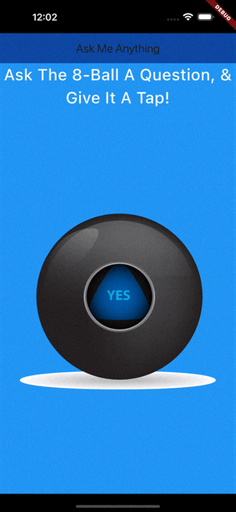
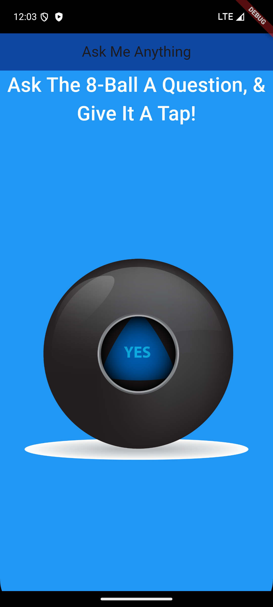
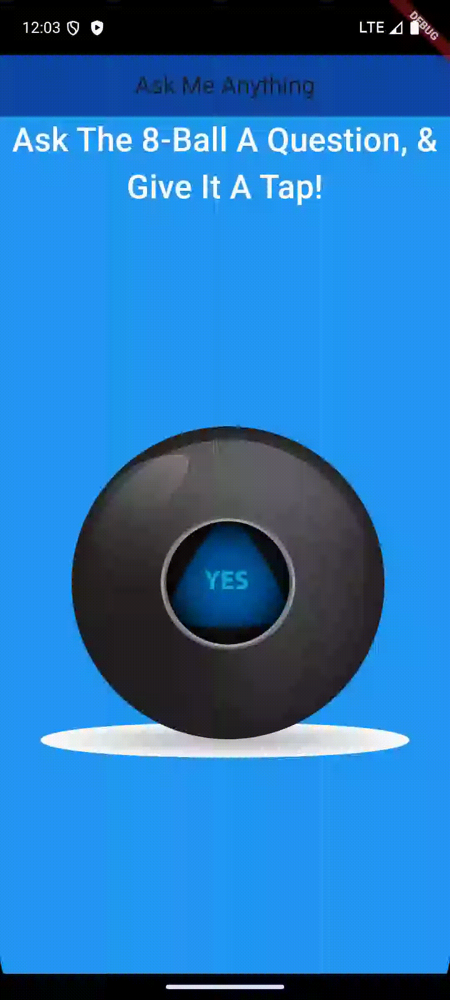

# Magic Eight Ball - Flutter Project

This Flutter Application is a simple 8-ball application. You should ask your phone a question, and give it a tap! By doing so, it will give you the wisdom you seek.

## 🚀 Features

- Simple image animation based on user action

## 🎯 Getting Started

### Prerequisites

To run this project, you will need:

- **Flutter SDK**
- **Xcode** (for iOS) and/or **Android Studio** (for Android)
- A connected iOS or Android device, or an emulator/simulator.
- Visual Studio Code [Download](https://code.visualstudio.com/download)

1. **Clone the repository**:
```bash
git clone https://github.com/coletoncodes/magic_8_ball.git
```
2. **CD to the cloned project**:
```bash
cd /path/to/magic_8_ball
```
3. **Open it in VSCode**:
```bash
code . #If code shell command is installed to terminal
```

Or
```bash
code /path/to/magic_8_ball #If code shell command is installed to terminal
```

4. **Update Dependencies**:
```bash
flutter pub get
```

### Running The App

#### iOS (Simulator)

1. **Open the project in XCode**:
    ```bash
    open ios/Runner.xcworkspace #Launches XCode
    ```

2. **Select simulator or device in XCode**

3. **Then press the run button in VSCode, or run**:
```bash
flutter run
```

#### You should see this output in the console if successful
```bash
quiz_app % flutter run                                                                                                                                                            (development)quiz_app
Launching lib/main.dart on iPhone 16 Pro Max in debug mode...
Running Xcode build...                                                  
 └─Compiling, linking and signing...                         3.3s
Xcode build done.                                           17.1s
```

### Note:
If you run into any issues with this approach, be sure to run the following commands to ensure you are setup

1. **Check flutter install/health**:
```bash
flutter doctor
```
2. **Check available devices**:
```bash
flutter devices
```

## 🛠️ Technologies Used

- Flutter: Cross-platform mobile development framework.
- Dart: Programming language for Flutter.

## 📱 Media

### iPhone Screenshots


### iPhone Recordings



### Android Screenshots



### Android Recordings



## Contact
[Connect With Me On LinkedIn](https://www.linkedin.com/in/coletongorecke/)
